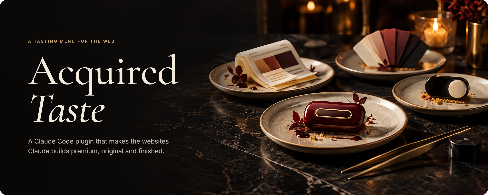
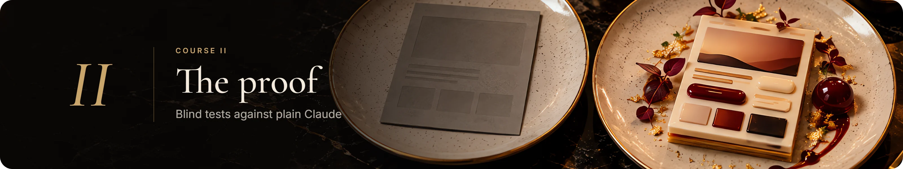
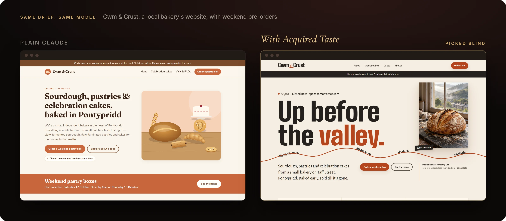
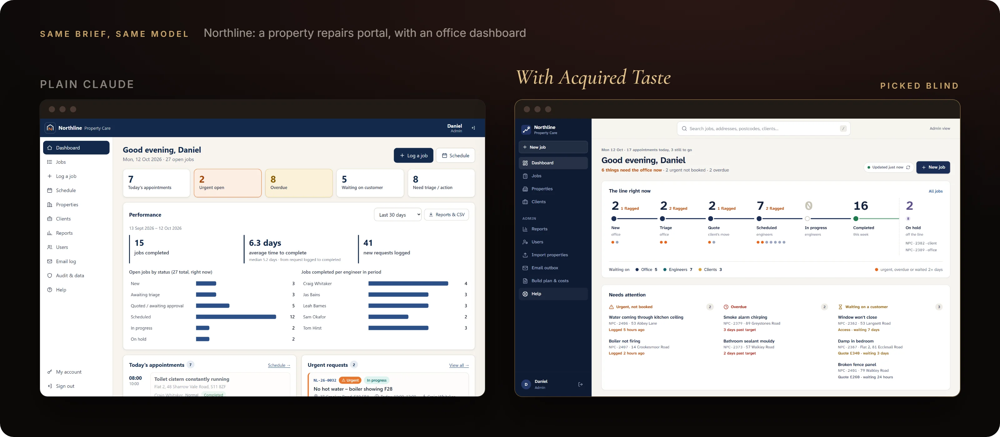
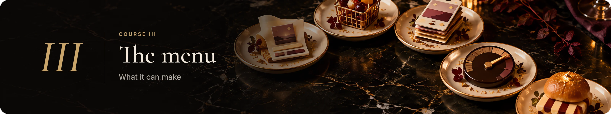
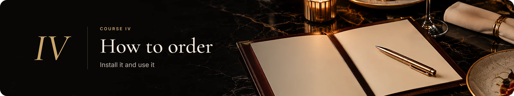
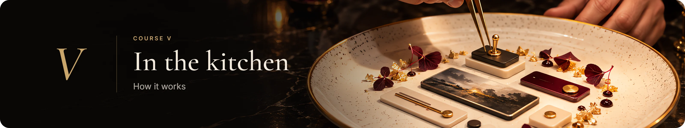
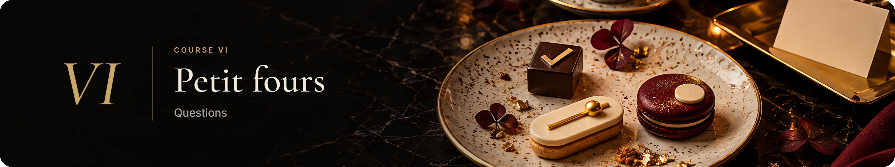

<p align="center">
  
</p>

<p align="center">
  
  
  
  
</p>

<p align="center">
  <b>Plain Claude builds websites that work. Acquired Taste makes them look like someone cared.</b>
</p>

<p align="center">
  <a href="#install">Install</a> &nbsp;·&nbsp;
  <a href="#use">How to use</a> &nbsp;·&nbsp;
  <a href="#proof">The proof</a> &nbsp;·&nbsp;
  <a href="#questions">Questions</a>
</p>

<br>


Ask Claude for a website and you get something sensible: a tidy layout, real copy, a working phone view. You also get the same site everyone else gets. Same hero, same three cards, same safe fonts, empty boxes where the pictures should be. It works, but it doesn't look finished.

Acquired Taste is a plugin for [Claude Code](https://claude.com/claude-code) that gives Claude a designer's process and the tools to carry it out:

- **A real design direction.** Before any code, it reads the brief and commits to an idea that only fits *this* business, with one signature moment that people remember.
- **Its own pictures.** It creates on-brand images for the site through your ChatGPT plan (optional), instead of stock photos or grey boxes.
- **Fonts found for the brief.** It searches free, commercial-use fonts for each project and compares them in a real interface before picking.
- **Motion and depth that hold up.** Tested animation blocks, not fragile one-off code.
- **It checks its own work.** It opens the site in a real browser at five screen sizes, light and dark, clicks through the important journeys, and fixes what's wrong before calling it done.
- **It learns your taste.** It remembers what you kept and what you rejected, and avoids repeating itself from one project to the next.

<br>

<a id="proof"></a>


The final test used two briefs written by someone else and kept sealed until the end: a Welsh bakery's website and a repairs portal for a property firm. Each one was built twice by the same model (Claude Opus 5.5), once plain and once with Acquired Taste. Then two people judged the pairs **blind**, shuffled A and B, with no idea what was being tested.

**Acquired Taste won all four picks.**





> "By a mile." *(on the bakery)*
>
> "Clear winner. Plain's dashboard looked nice too, but when actually used, this one came out on top." *(on the portal)*

It's a small test, not a study, and the cost is honest: Acquired Taste took a few minutes longer than plain Claude (2 more on the bakery, 11 more on the portal), because it checks everything it builds.

<br>



| | What "finished" means here |
|---|---|
| **Landing pages** | A visitor trusts it and clicks. A concept that runs through the whole page, not just the hero. |
| **Online shops** | Consistent product photos, filters people actually use, a basket that works. |
| **Local businesses** | Bakeries, barbers, cafés: opening hours, bookings and orders that feel like the place. |
| **Web app screens** | Calm, current interfaces with every state covered: loading, empty, error. |
| **Dashboards** | Spot what's wrong in five seconds, and still want it open all day. |
| **Redesigns** | Your existing site or app made beautiful, with everything that works still working. |

Ask for a mix ("a landing page and a staff dashboard") and it builds one project with one design system, each part following its own rules.

<br>

<a id="install"></a>


**You need:** [Claude Code](https://claude.com/claude-code) and [Node.js](https://nodejs.org) 18 or newer.

```bash
claude plugin marketplace add Ieuan0804/acquired-taste
claude plugin install acquired-taste@acquired-taste
```

Then run the setup check once: type `/acquired-taste:setup` in Claude Code. It installs the browser used for checking and tests everything is ready.

**Pictures (optional):** install the [Codex CLI](https://github.com/openai/codex) (`npm install -g @openai/codex`), run `codex login` and choose *Sign in with ChatGPT*. It uses your ChatGPT plan (Plus or higher), not an API key and not your Claude usage. Without it, sites use designed visuals made in code and clearly labelled photo spaces.

<details>
<summary><b>Setup and troubleshooting</b></summary>
<br>

**What "ready" looks like.** The setup check's first line says **Ready**, **Ready (pictures off)** (everything works; sites use code-made visuals because Codex isn't set up) or **NOT READY** (a `[fix]` line says what's needed). `[optional]` lines are extras you can skip.

**The checking browser.** Setup downloads a copy of Chromium (about 150 MB) from `cdn.playwright.dev`. If your network blocks that (some offices and cloud machines do), Acquired Taste uses an installed **Google Chrome**, **Microsoft Edge** or **Chromium** instead, or any browser you point it at:

```bash
export ACQUIRED_TASTE_BROWSER=/usr/bin/chromium        # Mac / Linux
$env:ACQUIRED_TASTE_BROWSER = "C:\path\to\chrome.exe"  # Windows PowerShell
```

If none of these is possible, sites are still built, but the browser checks can't run, and the hand-over says so.

**Where it lives.** Claude Code keeps the plugin in `~/.claude/plugins/cache/acquired-taste/`. Your saved taste (what you kept and rejected) is in `~/.acquired-taste/`. Each project's working files (screenshots, notes) are in its own `.acquired-taste/` folder, kept out of git.

**Update:**

```bash
claude plugin marketplace update acquired-taste
claude plugin update acquired-taste@acquired-taste
```

Then restart Claude Code.

**Uninstall:**

```bash
claude plugin uninstall acquired-taste@acquired-taste
claude plugin marketplace remove acquired-taste
```

Delete `~/.acquired-taste/` too if you don't want to keep your saved taste.

**Without a chat.** It works headless too, for scripts and automation: `claude -p "Build a website for ..."` builds and checks the site without stopping to ask, using its own picks and noting what it assumed. Headless runs can't approve actions, so give it permission to edit files and run commands (for example `--permission-mode acceptEdits` plus allowed tools, or `bypassPermissions` in a throwaway folder or sandbox).
</details>

<a id="use"></a>
### How to use it

1. **Ask for a website,** the way you'd brief a designer. *"Build a website for my bakery in Pontypridd. We sell sourdough and celebration cakes and want weekend pre-orders."* No command needed: it notices website requests by itself.
2. **Answer one check-in.** It shows its direction, font choices and picture options together, with its own pick for each. Reply "go", or change anything.
3. **Get a finished site.** It builds, checks, fixes, and hands over with how to run it, what it assumed, and what you should replace with real details.

**Redesigning something that already exists?** Open the project and say *"Redesign this. It works but it looks ugly. Keep everything working."* It reads the code and its tests first, changes only the look and layout, proves nothing broke, and writes up every change. Nothing is committed or pushed.

**Tips:** put your logo and brand files in a `brand/` folder, share links to sites you love, and say "quick draft" when you want speed over polish.

<br>



Every site goes through the same kitchen:

1. **The brief.** It reads what you gave it and asks only for what's genuinely missing.
2. **The design read.** A concept, a signature moment, type, colour, motion and a picture plan, all specific to the business. It passes a simple test: if a competitor could use the headline unchanged, it's rewritten.
3. **Ingredients.** Fonts are searched and compared, and pictures start generating in the background while it builds, so they don't add waiting time.
4. **Cooking.** A modern Next.js project (or your existing stack), with tested motion blocks for the moments that matter.
5. **Tasting.** A real browser checks every page at five widths for broken images, errors, sideways scrolling and squashed buttons. It clicks through the important journeys, captures motion as frames, then looks at everything with a designer's eye and fixes what's off.
6. **Remembering.** Your verdicts are saved locally, so the next project leans towards what you liked.

It also cleans up after itself. It starts and stops only its own servers, keeps its working files out of your git history, and never pushes, deploys or touches business logic during a redesign.

<br>

<a id="questions"></a>


<details>
<summary><b>Does it cost anything extra?</b></summary>
<br>
It runs on your normal Claude Code plan. Pictures are made through your ChatGPT plan via Codex, so they don't use your Claude usage. Both are optional extras you may already have; the plugin itself is free.
</details>

<details>
<summary><b>Do I need ChatGPT?</b></summary>
<br>
No. Without it, Acquired Taste uses visuals designed in code and clearly labelled spaces where real photos should go. It never fills them with random stock photos.
</details>

<details>
<summary><b>Won't every site look the same?</b></summary>
<br>
That's the problem it exists to fix. It remembers which fonts, ideas and layouts it used recently and avoids repeating them, and real random picks give each project a different starting point. Two runs of the same brief come out as genuinely different sites.
</details>

<details>
<summary><b>Whose taste is it?</b></summary>
<br>
Out of the box, its taste comes from its author's favourite websites and apps, and the verdicts on every test site it was built with. From your first project, it starts learning yours: what you keep and reject is saved on your computer and steers the next site.
</details>

<details>
<summary><b>Is it slower than plain Claude?</b></summary>
<br>
A little. It plans before building and checks everything in a real browser, which adds a few minutes. A typical website takes about 10 to 20 minutes from request to finished.
</details>

<details>
<summary><b>Can it redesign my existing site or app?</b></summary>
<br>
Yes. It reads the code and runs your own tests first, suggests how bold to go (a polish, a strong restyle, or a full overhaul) and lets you change it, keeps every feature and all your data logic untouched, and shows before and after. Apps behind a login are fine: it signs in with a test account.
</details>

<details>
<summary><b>What does it build with?</b></summary>
<br>
New sites use Next.js, so a landing page can grow into a customer area and a staff dashboard in one project. Existing projects keep their own framework.
</details>

<details>
<summary><b>Does it work on Mac and Linux?</b></summary>
<br>
Yes. It's built on Windows, and its tools are tested automatically on Mac, Linux and Windows.
</details>

<details>
<summary><b>Is anything sent anywhere?</b></summary>
<br>
Its memory is plain files on your machine (<code>~/.acquired-taste</code>). The only thing that leaves is the picture descriptions sent to ChatGPT when you use image generation.
</details>

<br>

---

<p align="center">
  <sub>Made by Ieuan Howells · MIT licence · Started life as a fork of <a href="https://github.com/Leonxlnx/taste-skill">Taste Skill</a>.</sub>
</p>
